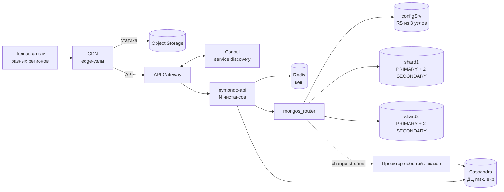
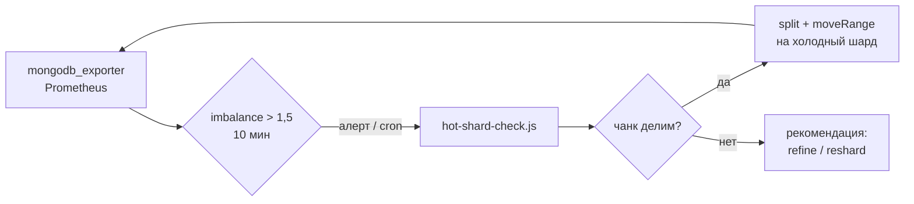
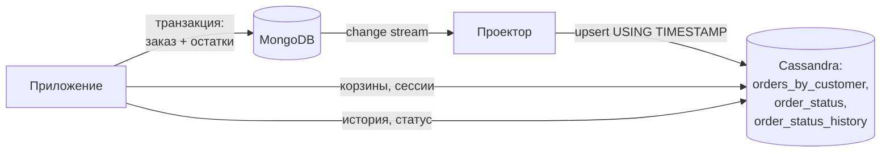

# Архитектурный документ «Мобильный мир»: задания 7–10

Документ описывает проектирование хранения данных онлайн-магазина «Мобильный мир» для пиковых нагрузок
(«чёрная пятница»):

| Задание | Тема |
|---|---|
| 7 | Схемы коллекций MongoDB и выбор шард-ключей |
| 8 | Выявление и устранение «горячих» шардов, метрики мониторинга |
| 9 | Чтение с реплик и консистентность |
| 10 | Перенос критически важных данных в Cassandra и стратегии восстановления целостности |

Подробные версии разделов, проверочные скрипты и схема Cassandra лежат в каталогах
[task7](task7/README.md), [task8](task8/README.md), [task9](task9/README.md), [task10](task10/README.md).
Все команды MongoDB проверены на кластере из задания 3 (MongoDB 9.0, два шарда по три реплики),
CQL — на Cassandra 5.0.9.

## Содержание

0. [Целевая архитектура](#0-целевая-архитектура)
1. [Задание 7. Схемы коллекций и шардирование](#1-задание-7-схемы-коллекций-и-шардирование)
2. [Задание 8. Горячие шарды](#2-задание-8-горячие-шарды)
3. [Задание 9. Чтение с реплик и консистентность](#3-задание-9-чтение-с-реплик-и-консистентность)
4. [Задание 10. Cassandra](#4-задание-10-cassandra)
5. [Мониторинг и действия при проблемах](#5-мониторинг-и-действия-при-проблемах)
6. [Сводка решений](#6-сводка-решений)

---

## 0. Целевая архитектура

### 0.1. Структура кластеров



| Компонент | Роль | Масштабирование |
|---|---|---|
| MongoDB, шардированный кластер | источник истины: заказы, товары, остатки, корзины до переноса в Cassandra | горизонтально — шарды; чтение — SECONDARY-реплики |
| Replica set шарда (3 узла) | отказоустойчивость, чтение с SECONDARY | добавление SECONDARY, скрытый узел для аналитики |
| Redis | кеш ответов API (каталог, карточки) | — |
| Cassandra (2 ДЦ × 3 реплики) | корзины, сессии, история заказов и статусы | линейно — узлы и дата-центры |
| Проектор | переносит события заказов из MongoDB в Cassandra | идемпотентные upsert |

### 0.2. Где хранятся данные

| Данные | Хранилище | Почему |
|---|---|---|
| Создание заказа + списание остатков | MongoDB, транзакция | нужна атомарность нескольких документов |
| Остатки товаров | MongoDB | условный декремент `$inc` с `$gte` |
| Каталог товаров | MongoDB + Redis + CDN | фильтрация и сортировка по разным полям, мало записей |
| Корзины | Cassandra (схема MongoDB — задание 7) | очень частая запись, доступ по владельцу, TTL |
| Сессии | Cassandra | key-value, запись на каждом запросе, TTL |
| История заказов, статусы | Cassandra (модель чтения) | растущий объём «только добавление», чтение по клиенту и заказу |

---

## 1. Задание 7. Схемы коллекций и шардирование

### 1.1. Операции и критерии

| Коллекция | Основные операции | Главное требование |
|---|---|---|
| `orders` | создание заказа со списанием остатков; история заказов пользователя; статус заказа | быстрая запись, адресное чтение по пользователю |
| `products` | частое обновление остатков; поиск по категории и цене; карточка товара | точечная запись по товару |
| `carts` | создание; получение активной корзины по `session_id` или `user_id`; изменение товаров; слияние гостевой корзины; отметка «заказана» | все операции над одной корзиной одного владельца |

Критерии шард-ключа: **высокая кардинальность**, **равномерность**, **отсутствие монотонности**,
**адресность частых запросов** (запрос с шард-ключом уходит на один шард, без scatter-gather).

### 1.2. Коллекция `orders`

| Поле | Тип BSON | Описание |
|---|---|---|
| `_id` | ObjectId | идентификатор заказа |
| `customer_id` | string | идентификатор клиента — **шард-ключ** |
| `created_at` | date | дата и время оформления |
| `items` | array of object `{ product_id: ObjectId, name: string, category: string, price: decimal, quantity: number }` | товары и цена на момент заказа |
| `status` | string, enum `created`, `paid`, `shipped`, `delivered`, `cancelled` | статус |
| `total` | decimal | сумма заказа |
| `geo_zone` | string | геозона заказа |

Сравнение кандидатов:

| Кандидат | Кардинальность | Распределение | Адресность | Вывод |
|---|---|---|---|---|
| `_id`, `created_at` | высокая | монотонные — все вставки в последний чанк | история пользователя — на все шарды | ❌ |
| `geo_zone` | низкая | перекос: Москва в разы больше; jumbo-чанки | история — на все шарды | ❌ |
| `status` | 5 значений | перекос; значение меняется | — | ❌ |
| **`customer_id` hashed** | высокая | равномерное по хешу | история и статус (`_id` + `customer_id`) — адресные | ✅ |

**Выбор: `{ customer_id: "hashed" }`.**
- Преимущества: пиковое создание заказов распределено по всем шардам; история пользователя и статус
  заказа — запросы на один шард (индекс `{ customer_id: 1, created_at: -1 }`).
- Риски: поиск заказа только по `_id` (служба поддержки) идёт на все шарды — операция редкая; при будущем
  геораспределении шардов ключ расширяется до `{ geo_zone: 1, customer_id: "hashed" }` с зонами.

### 1.3. Коллекция `products`

| Поле | Тип BSON | Описание |
|---|---|---|
| `_id` | ObjectId | идентификатор товара — **шард-ключ** |
| `name` | string | наименование |
| `category` | string | категория |
| `price` | decimal | цена |
| `stock` | object `{ <geo_zone>: number }`, значения ≥ 0 | остаток по геозонам; меняется атомарным `$inc` |
| `attributes` | object (`color`, `size`, …) | дополнительные атрибуты |

| Кандидат | Распределение | Адресность | Вывод |
|---|---|---|---|
| `category` | десятки значений, «Электроника» — один неделимый чанк, горячий шард | поиск по категории — адресный; списание остатков по `_id` — на все шарды | ❌ |
| `{ category: 1, _id: 1 }` | монотонность внутри категории | остатки адресные, только если в каждом запросе известна категория (в корзине её нет) | ⚠️ |
| **`_id` hashed** | равномерное | списание остатков и карточка — адресные | ✅ |

**Выбор: `{ _id: "hashed" }`.**
- Преимущества: самая частая запись (списание остатков) и карточка товара — на один шард; популярные товары
  разнесены по всем шардам.
- Риски: поиск по категории и цене идёт на все шарды. Компенсация: индекс `{ category: 1, price: 1 }` на каждом
  шарде, кеш Redis, CDN, чтение каталога с SECONDARY (задание 9). Коллекция компактная — рабочий набор в памяти.

### 1.4. Коллекция `carts`

| Поле | Тип BSON | Описание |
|---|---|---|
| `_id` | ObjectId | идентификатор корзины |
| `owner_id` | string, `u:<user_id>` или `s:<session_id>` | производное поле — **шард-ключ** |
| `user_id` | string или null | пользователь (null у гостя) |
| `session_id` | string или null | сессия гостя |
| `items` | array of object `{ product_id: ObjectId, quantity: number }` | товары |
| `status` | string, enum `active`, `ordered`, `abandoned` | статус |
| `created_at`, `updated_at` | date | создание и последнее изменение |
| `expires_at` | date | TTL-индекс удаляет корзину |

| Кандидат | Проблема | Вывод |
|---|---|---|
| `_id` hashed | корзину ищут по `session_id`/`user_id` — все поиски на все шарды | ❌ |
| `user_id` | у всех гостей `null` — один неделимый горячий чанк | ❌ |
| `session_id` | пользователь с другого устройства — поиск по `user_id` на все шарды | ❌ |
| **`owner_id` hashed** | один ключ для гостей и пользователей | ✅ |

**Выбор: `{ owner_id: "hashed" }`.**
- Преимущества: получение корзины гостя и пользователя — адресные; слияние — три адресные операции;
  шард-ключ корзины никогда не меняется; равномерное распределение.
- Риски: приложение обязано заполнять `owner_id` при создании корзины (проверяется валидатором `pattern: "^(u|s):"`).

### 1.5. Команды

```javascript
use shop
sh.enableSharding("shop")

sh.shardCollection("shop.orders",   { customer_id: "hashed" })
sh.shardCollection("shop.products", { _id: "hashed" })
sh.shardCollection("shop.carts",    { owner_id: "hashed" })

db.orders.createIndex({ customer_id: 1, created_at: -1 })        // история заказов
db.products.createIndex({ category: 1, price: 1 })                // каталог
db.carts.createIndex({ owner_id: 1, status: 1 },                  // одна активная корзина на владельца
  { unique: true, partialFilterExpression: { status: "active" } })
db.carts.createIndex({ expires_at: 1 }, { expireAfterSeconds: 0 })   // TTL
```

Валидаторы коллекций (`$jsonSchema` с типами из таблиц выше) приведены в [task7/README.md](task7/README.md#61-создание-коллекций-индексов-и-шардирование).
Остаток в валидаторе — `minimum: 0`, поэтому ошибочное списание в минус отклоняется (код 121).

Создание заказа со списанием остатков — распределённая транзакция, каждая операция в которой адресная:

```javascript
const session = db.getMongo().startSession();
const shop = session.getDatabase("shop");
session.startTransaction({ readConcern: { level: "snapshot" }, writeConcern: { w: "majority" } });
try {
  const r = shop.products.updateOne(
    { _id: productId, "stock.msk": { $gte: 1 } },          // шард по _id
    { $inc: { "stock.msk": -1 } });
  if (r.modifiedCount !== 1) throw new Error("Недостаточно товара");
  shop.orders.insertOne({ customer_id: "c-102938", created_at: new Date(),   // шард по customer_id
    items: [{ product_id: productId, price: NumberDecimal("59990.00"), quantity: 1 }],
    status: "created", total: NumberDecimal("59990.00"), geo_zone: "msk" });
  session.commitTransaction();
} catch (e) { session.abortTransaction(); throw e; } finally { session.endSession(); }
```

Корзина:

```javascript
db.carts.findOne({ owner_id: "s:9f8e7d6c", status: "active" })       // гость
db.carts.findOne({ owner_id: "u:c-102938", status: "active" })       // пользователь
db.carts.updateOne({ owner_id: "s:9f8e7d6c", status: "active" },
  { $pull: { items: { product_id: productId } }, $set: { updated_at: new Date() } })
```

Слияние гостевой корзины — транзакция из трёх адресных операций (прочитать гостевую, записать объединённые
товары в пользовательскую, отметить гостевую `abandoned`), код — в [task7/README.md](task7/README.md#65-слияние-гостевой-корзины-в-пользовательскую).

### 1.6. Проверка

| Запрос | `explain().queryPlanner.winningPlan.stage` |
|---|---|
| Корзина по `owner_id` | `SINGLE_SHARD` |
| История заказов по `customer_id` | `SINGLE_SHARD` |
| Статус заказа (`_id` + `customer_id`) | `SINGLE_SHARD` |
| Карточка товара по `_id` | `SINGLE_SHARD` |
| Товары по категории | `SHARD_MERGE` (все шарды — ожидаемо) |

Транзакция откатывается при нехватке остатка; слияние корзин суммирует количества; вторая активная корзина
и отрицательный остаток отклоняются.

---

## 2. Задание 8. Горячие шарды

### 2.1. Причины

| Причина | Проявление |
|---|---|
| Ключ с низкой кардинальностью (`{ category: 1 }`) | вся «Электроника» — один неделимый чанк на одном шарде |
| Монотонный ключ (ObjectId, дата) | все вставки в последний чанк |
| Горячие документы | остаток популярного товара — один документ, все списания на один шард |
| **Балансировщик выравнивает объём, а не нагрузку** | при равном объёме данных горячий по нагрузке шард считается сбалансированным |

Воспроизведение: 20 000 товаров, 70% — «Электроника», ключ `{ category: 1 }`, 70% запросов — к «Электронике».

| | shard1 | shard2 |
|---|---|---|
| Документов | 30% | 70% |
| Операций | 17,7% | **82,3%** |
| `sh.balancerCollectionStatus()` | `balancerCompliant: true` | |

### 2.2. Метрики

Главная метрика — **коэффициент дисбаланса** = значение на шарде / среднее по шардам.
Норма ≈ 1; предупреждение > 1,5 (10 мин); критично > 2.

| Группа | Метрика | Источник | Порог |
|---|---|---|---|
| Нагрузка | операций/с по шарду | `serverStatus().opcounters` на PRIMARY | imbalance > 1,5 |
| Нагрузка | операций по коллекции на каждом шарде | `$collStats: { latencyStats: {} }` через mongos | доля шарда > 1,5 / число шардов |
| Нагрузка | задержка операций | `serverStatus().opLatencies` | p99 > 100 мс или imbalance > 2 |
| Нагрузка | медленные запросы | профилировщик, лог `Slow query` | рост на одном шарде |
| Ресурсы | CPU, диск | node_exporter | > 80% 5 мин |
| Ресурсы | кеш WiredTiger (заполнение, dirty) | `serverStatus().wiredTiger.cache` | > 95%, dirty > 20% |
| Ресурсы | очереди и тикеты | `globalLock.currentQueue`, `queues.execution` | очередь > 0 дольше 1 мин |
| Ресурсы | отставание реплик | `rs.status()` | > 10 с |
| Данные | документы и байты на шарде | `$shardedDataDistribution` | imbalance > 1,3 |
| Данные | jumbo-чанки | `config.chunks.find({ jumbo: true })` | > 0 |
| Ключ | кардинальность, частые значения, распределение запросов по диапазонам | `analyzeShardKey`, `configureQueryAnalyzer` | — |
| Балансировщик | состояние, миграции, очередь удаления orphans | `balancerStatus`, `config.changelog`, `config.rangeDeletions` | ошибки миграций > 0 |

```javascript
// Нагрузка на коллекцию по шардам (счётчики накопительные — считать разницу замеров)
db.products.aggregate([{ $collStats: { latencyStats: {} } },
  { $project: { shard: 1, reads: "$latencyStats.reads.ops", writes: "$latencyStats.writes.ops" } }])

// Распределение данных без orphan-документов
db.getSiblingDB("admin").aggregate([{ $shardedDataDistribution: {} }, { $match: { ns: "shop.products" } }])

// Качество ключа
db.adminCommand({ analyzeShardKey: "shop.products", key: { category: 1 }, keyCharacteristics: true, readWriteDistribution: false })
// → numDistinctValues: 4, mostCommonValues: electronics 14000, audio/home/toys по 4000
```

Правило Prometheus (percona/mongodb_exporter, метка `shard` задаётся при сборе):

```yaml
- record: shard:ops:rate5m
  expr: sum by (shard) (rate(mongodb_ss_opcounters{role="primary", legacy_op_type!="command"}[5m]))
- alert: MongoHotShard
  expr: shard:ops:rate5m / scalar(avg(shard:ops:rate5m)) > 1.5
  for: 10m
```

### 2.3. Меры устранения

| Мера | Когда | Эффект | Риск / цена |
|---|---|---|---|
| Чтение каталога с SECONDARY, кеш Redis, CDN | сразу | снимает чтение с PRIMARY горячего шарда | данные до 90 с устаревают (задание 9) |
| `split` + `moveRange` горячего чанка | ключ делим | нагрузка делится между шардами | orphans удаляются через `orphanCleanupDelaySecs` (3600 с в 9.0); новый перенос того же диапазона ждёт |
| `refineCollectionShardKey` | ключ неделим, нужно быстро | чанк категории становится делимым без перемещения данных | суффикс `_id` монотонен внутри категории |
| `reshardCollection` | структурное исправление | ключ `{ category: 1, _id: "hashed" }`: категории адресны, внутри — хеш | нагрузка и место на шардах, запускать вне пика |
| Зоны | постоянно популярная категория | под категорию выделяется несколько (более мощных) шардов | нужен делимый ключ |
| `addShard` | общий рост | балансировщик переносит часть чанков | — |
| Коллекция `stocks` (`_id: "<product>:<zone>"`, hashed) | горячий товар | списания одного товара по регионам — на разные шарды | доп. коллекция в транзакции заказа |

```javascript
// Разделить и перенести
sh.splitAt("shop.products", { category: "electronics", _id: ObjectId("6af5ab0652cb0a797266fb52") })
db.adminCommand({ moveRange: "shop.products",
  min: { category: "electronics", _id: ObjectId("6af5ab0652cb0a797266fb52") },
  max: { category: "home", _id: MinKey }, toShard: "shard1" })

// Изменить ключ
db.adminCommand({ refineCollectionShardKey: "shop.products", key: { category: 1, _id: 1 } })
sh.reshardCollection("shop.products", { category: 1, _id: "hashed" })      // 20 000 документов — 37 с

// Зона для популярной категории
sh.addShardToZone("shard2", "electronics"); sh.addShardToZone("shard3", "electronics")
sh.updateZoneKeyRange("shop.products",
  { category: "electronics", _id: MinKey }, { category: "electronics", _id: MaxKey }, "electronics")

// Балансировщик: меньший чанк для горячей коллекции
db.adminCommand({ configureCollectionBalancing: "shop.products", chunkSize: 32 })
```

### 2.4. Автоматическое перераспределение

Штатный балансировщик дополняется контуром, выравнивающим **нагрузку**:



Скрипт [task8/scripts/hot-shard-check.js](task8/scripts/hot-shard-check.js) дважды снимает `$collStats` всех
шардированных коллекций, считает коэффициент дисбаланса и в режиме `HOT_AUTO_MOVE=true` делит чанк горячей
коллекции пополам и переносит половину на наименее нагруженный шард (не больше `HOT_MAX_MOVES` за запуск).

| Состояние | shard1 / shard2 | Операций за 15 с |
|---|---|---|
| Ключ `{ category: 1 }` — скрипт: «chunk is indivisible», рекомендует refine/reshard | 18% / 82% | 2670 |
| После `refineCollectionShardKey` и одного автоматического переноса | 54% / 46% | 6314 |

Пропускная способность выросла в 2,4 раза при той же нагрузке.

---

## 3. Задание 9. Чтение с реплик и консистентность

### 3.1. Механизмы и классы задержки

| Механизм | Назначение |
|---|---|
| `readPreference: primary` / `secondaryPreferred` / `secondary` | откуда читать |
| `maxStalenessSeconds` | не читать с SECONDARY, отставшего больше N секунд; **минимум 90 с** |
| `readConcern: majority` | только данные, подтверждённые большинством (не откатятся) |
| Причинная сессия | read-your-writes при чтении с SECONDARY |
| `writeConcern: { w: "majority" }` | все записи; условие корректности чтений `majority` и причинных сессий |

| Класс | Допустимая задержка | Настройка |
|---|---|---|
| **A** — строгая консистентность | 0 | `primary` (+ `majority` / `snapshot`) |
| **B** — почти актуальные данные | до 90 с (обычно < 1 с) | `secondaryPreferred` + `maxStalenessSeconds: 90` |
| **C** — аналитика | до 15 мин | `secondary`, скрытый узел |

### 3.2. Операции чтения

| Коллекция | Операция | Узел | Задержка | Обоснование |
|---|---|---|---|---|
| products | каталог: категория, цена | secondary | B | самое частое чтение; цена и наличие перепроверяются при заказе |
| products | карточка товара | secondary | B | описание и цена меняются редко |
| products | отображение наличия | secondary | B | информация, а не резерв; списание условное на PRIMARY |
| products | проверка остатка и цены при заказе | **primary** | A | риск продать отсутствующий товар или по старой цене |
| products | остатки для склада и администратора | **primary** | A | решения о закупке по точным данным |
| products | аналитика | secondary | C | тяжёлые агрегации не нагружают PRIMARY |
| orders | заказ сразу после создания | **primary** | A | read-your-writes |
| orders | статус заказа | **primary** | A | устаревший статус → повторная оплата, обращения в поддержку |
| orders | история заказов | secondary + причинная сессия | B; свои записи — 0 | частое чтение, старые заказы не меняются; свой новый заказ не пропадает |
| orders | проверки перед оплатой, отменой, возвратом | **primary** | A | по результату движутся деньги |
| orders | служба поддержки | **primary** | A | оператор меняет заказ |
| orders | аналитика | secondary | C | — |
| carts | текущая корзина, счётчик в шапке | **primary** | A | читается сразу после каждой записи; отставание = «товар пропал» |
| carts | слияние, корзина при оформлении заказа | **primary** | A | транзакция; состав заказа = то, что видел пользователь |
| carts | аналитика брошенных корзин | secondary | C | пакетная обработка |

Частота обновлений как основание: товары читают на порядки чаще, чем меняют (остатки — при покупке,
описания — несколько раз в день), поэтому их чтение выносится на SECONDARY; статусы заказов меняются редко,
но каждое изменение критично; корзины меняются на каждом действии пользователя и сразу читаются.

### 3.3. Настройка

```
# A
mongodb://mongos_router:27020/shop?readPreference=primary&readConcernLevel=majority&w=majority
# B
mongodb://mongos_router:27020/shop?readPreference=secondaryPreferred&maxStalenessSeconds=90&w=majority
# C
mongodb://mongos_router:27020/shop?readPreference=secondary&maxStalenessSeconds=900
```

```javascript
// В mongosh maxStalenessSeconds передаётся опцией find(), а не третьим аргументом readPref()
db.products.find({ category: "electronics" }, {},
  { readPreference: { mode: "secondaryPreferred", maxStalenessSeconds: 90 } })

db.orders.find({ _id: orderId, customer_id: "c-102938" }).readPref("primary").readConcern("majority")
```

Проверка через `explain()`: запрос с `secondaryPreferred` обслужили SECONDARY (`shard1-2`, `shard2-3`), с `primary` —
PRIMARY (`shard1-1`, `shard2-1`); `maxStalenessSeconds: 30` отклоняется; в причинной сессии только что
записанный заказ виден при чтении с SECONDARY.

### 3.4. Задержка репликации

| Задержка | Действие |
|---|---|
| < 1 с | норма |
| > 10 с дольше 1 мин | алерт, поиск причины (перегрузка PRIMARY, диск, сеть, горячий шард) |
| > 90 с | SECONDARY автоматически исключается из чтений класса B; чтение уходит на другие узлы или PRIMARY |
| > 15 мин | узел не годится и для аналитики; при угрозе выхода за окно oplog — пересинхронизация |

```javascript
rs.printSecondaryReplicationInfo()
```

---

## 4. Задание 10. Cassandra

### 4.1. Выбор данных

| Данные | Целостность | Скорость | Запись | Доступ | Решение |
|---|---|---|---|---|---|
| Создание заказа + остатки | **критична** | важна | средняя | транзакция нескольких сущностей | MongoDB: нет межпартиционных транзакций; счётчики Cassandra не идемпотентны и не проверяют `≥ 0`; LWT на горячем товаре — конфликты Paxos |
| Каталог | важна | важна | низкая | фильтры, сортировка | MongoDB |
| **Корзины** | средняя | **критична** | **очень высокая** | по владельцу | ✅ Cassandra |
| **Сессии** | низкая | **критична** | **очень высокая** | по `session_id` | ✅ Cassandra |
| **История заказов, статусы** | высокая | важна | растущий объём, только добавление | по клиенту / заказу | ✅ Cassandra (модель чтения) |

Обоснование: Cassandra даёт линейное масштабирование записи, работу без единственного PRIMARY,
геораспределённость (`LOCAL_QUORUM` в своём ДЦ) и встроенный TTL. Это то, что нужно корзинам, сессиям и
истории. Атомарность денег и остатков остаётся за MongoDB.

Поток заказов:



### 4.2. Топология

```sql
CREATE KEYSPACE shop
  WITH replication = { 'class': 'NetworkTopologyStrategy', 'msk': 3, 'ekb': 3 };
```

Два дата-центра по 3 реплики; запись и чтение — `LOCAL_QUORUM`; `Murmur3Partitioner`;
`num_tokens: 16`, `allocate_tokens_for_local_replication_factor: 3`.

### 4.3. Таблицы и ключи

```sql
CREATE TYPE order_item (product_id uuid, name text, category text, price decimal, quantity int);

CREATE TABLE carts_by_owner (
  owner_id text, product_id uuid, quantity int, added_at timestamp,
  cart_id uuid STATIC, user_id text STATIC, session_id text STATIC,
  created_at timestamp STATIC, updated_at timestamp STATIC,
  PRIMARY KEY ((owner_id), product_id)
) WITH default_time_to_live = 604800 AND gc_grace_seconds = 172800 AND read_repair = 'BLOCKING';

CREATE TABLE sessions (
  session_id text, user_id text, created_at timestamp, last_seen timestamp,
  revoked boolean, geo_zone text, attributes map<text, text>,
  PRIMARY KEY ((session_id))
) WITH default_time_to_live = 1800 AND gc_grace_seconds = 3600 AND read_repair = 'NONE'
  AND compaction = { 'class': 'TimeWindowCompactionStrategy', 'compaction_window_unit': 'HOURS', 'compaction_window_size': 1 };

CREATE TABLE sessions_by_user (
  user_id text, session_id text, created_at timestamp, last_seen timestamp, user_agent text,
  PRIMARY KEY ((user_id), session_id)
) WITH default_time_to_live = 1800 AND gc_grace_seconds = 3600 AND read_repair = 'NONE';

CREATE TABLE orders_by_customer (
  customer_id text, year smallint, created_at timestamp, order_id uuid,
  status text, total decimal, geo_zone text,
  items frozen<list<frozen<order_item>>>, updated_at timestamp,
  PRIMARY KEY ((customer_id, year), created_at, order_id)
) WITH CLUSTERING ORDER BY (created_at DESC, order_id ASC) AND read_repair = 'BLOCKING'
  AND compaction = { 'class': 'LeveledCompactionStrategy' };

CREATE TABLE order_status (
  order_id uuid, customer_id text, created_at timestamp, status text, total decimal, updated_at timestamp,
  PRIMARY KEY ((order_id))
) WITH read_repair = 'BLOCKING';

CREATE TABLE order_status_history (
  order_id uuid, changed_at timeuuid, status text, source text, comment text,
  PRIMARY KEY ((order_id), changed_at)
) WITH CLUSTERING ORDER BY (changed_at DESC) AND read_repair = 'BLOCKING';
```

Полная схема со всеми опциями — [task10/schema.cql](task10/schema.cql).

| Таблица | Partition key | Clustering key | Преимущества | Риски и как закрыты |
|---|---|---|---|---|
| `carts_by_owner` | `owner_id` | `product_id` | вся корзина — одна партиция; изменение товара — upsert одной строки, без конфликтов между вкладками; TTL удаляет брошенные корзины | удаления товаров создают tombstones → ежедневный repair, `gc_grace_seconds` = 2 дня |
| `sessions` | `session_id` | — | случайный токен — идеальное распределение; точечное чтение | удаление при выходе могло бы «воскреснуть» → выход = флаг `revoked`, без tombstones |
| `sessions_by_user` | `user_id` | `session_id` | «выйти на всех устройствах» | партиция маленькая (единицы сессий) |
| `orders_by_customer` | `(customer_id, year)` | `created_at DESC, order_id` | новые заказы сверху без сортировки; постраничная выдача | без года партиция оптовика росла бы бесконечно; год ограничивает её |
| `order_status` | `order_id` | — | точечное чтение статуса | — |
| `order_status_history` | `order_id` | `changed_at DESC` | журнал «только добавление» | — |

Запросы:

```sql
SELECT product_id, quantity FROM carts_by_owner WHERE owner_id = 's:9f8e7d6c';

UPDATE carts_by_owner USING TTL 604800 SET quantity = 2, updated_at = toTimestamp(now())
  WHERE owner_id = 's:9f8e7d6c' AND product_id = 5f0c4a52-1c8e-4b8b-9a51-0d6f3c1e2a01;

-- Слияние корзин
BEGIN BATCH
  UPDATE carts_by_owner USING TTL 604800 SET quantity = 3, updated_at = toTimestamp(now())
    WHERE owner_id = 'u:c-102938' AND product_id = 5f0c4a52-1c8e-4b8b-9a51-0d6f3c1e2a01;
  DELETE FROM carts_by_owner WHERE owner_id = 's:9f8e7d6c';
APPLY BATCH;

UPDATE sessions USING TTL 1800 SET revoked = true WHERE session_id = 'a1b2c3d4e5f6';

SELECT order_id, created_at, status, total FROM orders_by_customer
  WHERE customer_id = 'c-102938' AND year = 2026 LIMIT 20;

-- Смена статуса проектором: время события из MongoDB защищает от нарушенного порядка
BEGIN BATCH USING TIMESTAMP 1795000000000000
  UPDATE order_status SET status = 'paid', updated_at = '2026-11-27 10:20:00+0000'
    WHERE order_id = 0b8f9c2e-6a1d-4c3b-8e5f-2a9d7c4b1e30;
  INSERT INTO order_status_history (order_id, changed_at, status, source)
    VALUES (0b8f9c2e-6a1d-4c3b-8e5f-2a9d7c4b1e30, 50554d6e-29bb-11e5-b345-feff819cdc9f, 'paid', 'payment');
APPLY BATCH;
```

### 4.4. Горячие партиции и изменение топологии

| Таблица | Риск | Почему не горячая |
|---|---|---|
| `carts_by_owner` | всплеск гостевых корзин | миллионы маленьких партиций, распределённых хешем |
| `sessions` | проверка на каждом запросе | партиция = одна строка со случайным ключом |
| `orders_by_customer` | активный оптовик | год ограничивает партицию; читает свою историю один клиент |
| `order_status*` | массовая смена статусов | партиция = один заказ |

Модель сознательно не использует партиционирование по дате (все записи дня — одна партиция; для аналитики —
бакетирование `((day, bucket), …)`, `bucket = hash(order_id) % 32`), по категории или товару (горячая
«Электроника») и по низкокардинальным полям.

Изменение топологии не требует решардинга, в отличие от MongoDB (задание 8):
- консистентное хеширование — новый узел забирает диапазоны токенов, ключи не пересчитываются;
- vnodes — данные для нового узла приходят понемногу со многих узлов;
- нет чанков и балансировщика — равномерность обеспечивает хеш, неделимых горячих партиций модель не допускает;
- новый регион — новый ДЦ в `replication` и `nodetool rebuild`.

### 4.5. Стратегии восстановления целостности

| Механизм | Как работает | Цена |
|---|---|---|
| Hinted Handoff | координатор хранит запись для недоступной реплики до `max_hint_window` (3 ч) и доставляет при возвращении | почти бесплатно; не гарантия |
| Read Repair (`BLOCKING`) | при кворумном чтении расходящиеся реплики исправляются до ответа | задержка на чтениях с расхождением |
| Anti-Entropy Repair | сравнение деревьев Меркла, передача различий; обязателен в пределах `gc_grace_seconds` | фоновая нагрузка |

| Сущность | Запись / чтение | Hinted Handoff | Read Repair | Anti-Entropy Repair | Обоснование |
|---|---|---|---|---|---|
| Корзины | `LOCAL_QUORUM` / `LOCAL_QUORUM` | ✅ | `BLOCKING` | ежедневно, инкрементальный | быстрые записи не теряются при кратком отказе; товары не «прыгают» при чтении; удалённые товары не воскресают |
| Сессии | `LOCAL_QUORUM` / `LOCAL_ONE` | ✅ | `NONE` | не нужен | минимальная задержка на каждом запросе; TTL 30 мин, удалений нет; при промахе — повтор с `LOCAL_QUORUM` |
| История заказов, статусы | `LOCAL_QUORUM` (финальные статусы — `EACH_QUORUM`) / `LOCAL_QUORUM` | ✅ | `BLOCKING` | ежедневно инкрементальный + еженедельно полный | статус «оплачен» не откатится; старые заказы, которые никто не читает, тоже согласованы; источник истины — MongoDB, события можно переиграть |

```yaml
# cassandra.yaml
hinted_handoff_enabled: true
max_hint_window: 3h
num_tokens: 16
allocate_tokens_for_local_replication_factor: 3
```

```shell
nodetool repair -pr shop carts_by_owner orders_by_customer order_status order_status_history          # ежедневно
nodetool repair -pr -full shop orders_by_customer order_status order_status_history                    # еженедельно
```

Проверено на Cassandra 5.0.9: таблицы созданы с указанными `read_repair`, `gc_grace_seconds` и TTL; слияние
корзин суммирует количества и удаляет гостевую партицию; событие с более ранним `USING TIMESTAMP`, пришедшее
позже, не перезаписывает статус `paid`. Многоузловой кластер не поднимался, поэтому механизмы восстановления
на практике не проверены.

---

## 5. Мониторинг и действия при проблемах

### 5.1. Метрики

| Система | Метрика | Источник | Порог |
|---|---|---|---|
| MongoDB, шарды | коэффициент дисбаланса операций по шардам | `opcounters`, `$collStats` | > 1,5 (10 мин) |
| MongoDB, шарды | задержка операций | `opLatencies` | p99 > 100 мс |
| MongoDB, шарды | очереди, тикеты, кеш WiredTiger, CPU, диск | `serverStatus`, node_exporter | очередь > 0 1 мин; кеш > 95%; CPU > 80% |
| MongoDB, данные | дисбаланс объёма, jumbo-чанки | `$shardedDataDistribution`, `config.chunks` | > 1,3; jumbo > 0 |
| MongoDB, балансировщик | состояние, ошибки миграций, очередь `rangeDeletions` | `balancerStatus`, `config.changelog` | `mode != full`; ошибки > 0 |
| MongoDB, реплики | отставание SECONDARY | `rs.status()` | > 10 с; > 90 с — критично |
| MongoDB, реплики | смены PRIMARY | `rs.status()`, лог | > 1 за час |
| Cassandra | задержка чтения и записи по таблицам (p99) | `nodetool tablehistograms`, JMX | чтение > 20 мс, запись > 10 мс |
| Cassandra | размер партиций (макс.) | `nodetool tablestats` / `tablehistograms` | > 100 МБ |
| Cassandra | tombstones на чтение | `nodetool tablestats`, предупреждения в логе | > 1000 |
| Cassandra | отброшенные сообщения (dropped mutations/reads) | `nodetool tpstats` | > 0 |
| Cassandra | hints в ожидании доставки | `nodetool listpendinghints`, JMX `Storage.TotalHints` | рост дольше часа |
| Cassandra | ожидающие компакции | `nodetool compactionstats` | > 100 |
| Cassandra | состояние узлов | `nodetool status` | узел `DN` |
| Cassandra | давность последнего repair таблицы | Cassandra Reaper | > `gc_grace_seconds` |

### 5.2. Действия

| Проблема | Признак | Действия |
|---|---|---|
| Горячий шард MongoDB | дисбаланс > 1,5, задержки на одном шарде | 1) `$collStats` — найти коллекцию; `analyzeShardKey` — проверить ключ; 2) чтение каталога на SECONDARY, увеличить TTL кеша; 3) `hot-shard-check.js` с `HOT_AUTO_MOVE=true` (split + moveRange); 4) если чанк неделим — `refineCollectionShardKey`, затем `reshardCollection` вне пика; 5) для постоянной нагрузки — зоны или новый шард |
| Перекос объёма данных | `$shardedDataDistribution` > 1,3, jumbo-чанки | проверить, что балансировщик включён; уточнить ключ; разделить jumbo-чанки |
| Отставание реплик MongoDB | лаг > 10 с | найти причину на PRIMARY (нагрузка, диск); разгрузить PRIMARY; при лаге > 90 с чтения класса B уходят с этого узла автоматически; при угрозе выхода за окно oplog — увеличить oplog или пересинхронизировать узел |
| Устаревшие данные у пользователя | жалобы на «старый статус» | проверить, что операция читает с PRIMARY по таблице 3.2; проверить `writeConcern: majority` на записи |
| Медленные запросы Cassandra | p99 растёт | `nodetool tablestats` — большие партиции и tombstones; пересмотреть модель (бакетирование), проверить компакции |
| Узел Cassandra недоступен | `nodetool status` = `DN` | до 3 ч hints восстановят его сами; дольше — `nodetool repair` на узле после возвращения; при замене узла — `replace_address_first_boot` |
| Рассогласование реплик Cassandra | расхождения при read repair, пропущенный repair | внеплановый `nodetool repair -full` для таблицы; для истории заказов — переиграть события change stream из MongoDB |
| «Воскресшие» удалённые данные | удалённый товар снова в корзине | repair не успел за `gc_grace_seconds` — проверить расписание Reaper, выполнить repair, удалить строки повторно |

---

## 6. Сводка решений

| Решение | Выбор | Главная причина |
|---|---|---|
| Шард-ключ `orders` | `{ customer_id: "hashed" }` | равномерная запись, адресные история и статус |
| Шард-ключ `products` | `{ _id: "hashed" }` | адресное списание остатков; горячие товары разнесены |
| Шард-ключ `carts` | `{ owner_id: "hashed" }` | один ключ для гостей и пользователей |
| Горячие шарды | метрики дисбаланса + `hot-shard-check.js` + refine/reshard/зоны | балансировщик MongoDB не видит нагрузку |
| Чтение с реплик | каталог и история — SECONDARY (≤ 90 с); деньги, статусы, корзины — PRIMARY | цена ошибки vs нагрузка на PRIMARY |
| Cassandra | корзины, сессии, история заказов и статусы | масштаб записи, геораспределённость, TTL |
| Partition keys Cassandra | `owner_id`, `session_id`, `(customer_id, year)`, `order_id` | маленькие равномерные партиции, нет решардинга |
| Восстановление Cassandra | сессии — только hints; корзины и заказы — hints + read repair + repair | задержка vs гарантии согласованности |
